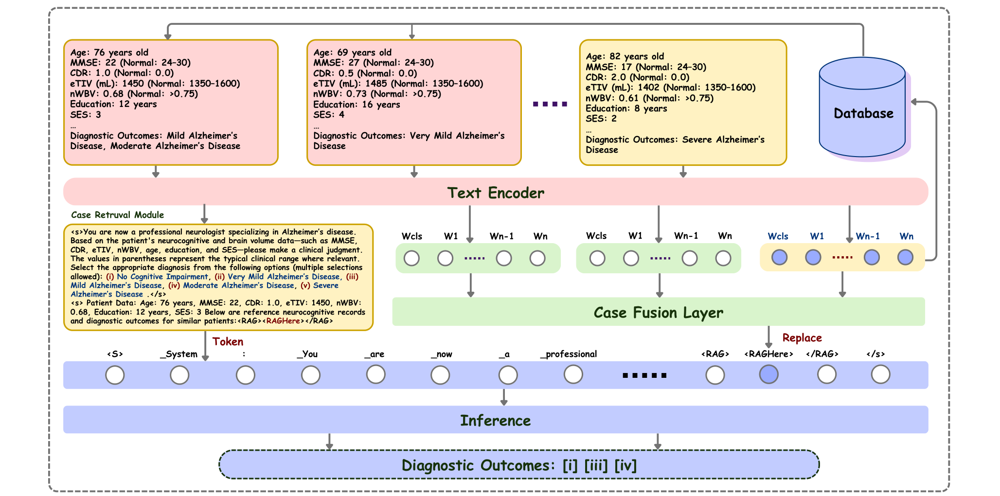

<div align="center">

# BRAINS: A Retrieval-Augmented System for Alzheimer's Detection and Monitoring

**Biomedical Retrieval-Augmented Intelligence for Neurodegeneration Screening**

[Rajan Das Gupta](https://rajandasguptaml.github.io/)<sup>1,4</sup> · Md Kishor Morol<sup>4,†</sup> · Nafiz Fahad<sup>2,4</sup> · Md Tanzib Hosain<sup>1,4</sup> · Sumaya Binte Zilani Choya<sup>3,4</sup> · Md Jakir Hossen<sup>2,4,†</sup>

<sup>1</sup>American International University-Bangladesh · <sup>2</sup>Multimedia University · <sup>3</sup>George Mason University · <sup>4</sup>ELITE Research Lab
<sup>†</sup>Corresponding authors

**IEEE ICMLA 2025** · 24th International Conference on Machine Learning and Applications

[](https://doi.org/10.1109/ICMLA66185.2025.00224)
[](https://arxiv.org/abs/2511.02490)
[](https://rajandasguptaml.github.io/BRAINS/)
[](https://github.com/rajandasguptaml/BRAINS/actions/workflows/ci.yml)
[](LICENSE)
[](requirements.txt)



*The input case is encoded and used to retrieve similar neurocognitive records. Retrieved cases are fused with the input through the Case Fusion Layer, which replaces the `<RAGHere>` token in the prompt. The fused representation is passed to the LLM for inference and explanation.*

</div>

## Overview

Early Alzheimer's detection depends on specialists and imaging that are scarce outside large cities. BRAINS turns
routine measurements (MMSE, CDR, eTIV, nWBV, age, education, SES) into a staged diagnosis by letting a language model
reason over the patient together with the most similar historical cases:

- **Case Retrieval Module.** The patient profile is encoded, matched against a FAISS memory of past cases by cosine
  similarity, reranked (bge-reranker-large) and the top-K = 5 cases are kept.
- **Case Fusion Layer.** A cross-attention block fuses the retrieved cases with the input case into one vector that
  replaces the `<RAGHere>` token embedding inside the clinical prompt, so up to five cases fit regardless of the
  context window.
- **Diagnostic Module.** LLaMA2-13B, pre-trained on curated Alzheimer's literature and fine-tuned with LoRA on
  structured diagnostic records, produces the outcome set and the retrieved cases serve as inspectable evidence.

**Results.** On the clinical test set, BRAINS reaches **77.3% correct** diagnoses and **0.819 F1**, against 60.0% /
0.538 for fine-tuning alone and 72.7% / 0.755 for the strongest retrieval baseline. The gain is largest on the hardest
triple-diagnosis cases (F1 0.929 vs 0.863).

| Model | All Correct | All F1 | Single P | Single R | Single F1 | Double P | Double R | Double F1 | Triple P | Triple R | Triple F1 |
|---|---|---|---|---|---|---|---|---|---|---|---|
| LLaMA2-13B five-shot | 0.335 | 0.339 | 0.000 | 0.000 | 0.000 | 0.299 | 0.719 | 0.423 | 0.421 | 0.980 | 0.591 |
| LLaMA2-13B fine-tuning | 0.600 | 0.538 | 0.657 | 0.728 | 0.692 | 0.468 | 0.474 | 0.471 | 0.643 | 0.281 | 0.391 |
| LLaMA2-13B w/o standard | 0.454 | 0.376 | 0.645 | 0.513 | 0.571 | 0.290 | 0.500 | 0.361 | 0.250 | 0.063 | 0.100 |
| RAG-1 | 0.712 | 0.731 | 0.766 | 0.540 | 0.619 | 0.703 | 0.824 | 0.802 | 0.774 | 0.981 | 0.863 |
| RAG-2 | 0.727 | 0.755 | 0.790 | 0.572 | 0.664 | 0.660 | 0.921 | 0.769 | 0.727 | 0.975 | 0.842 |
| **BRAINS** | **0.773** | **0.819** | **0.784** | **0.731** | **0.740** | **0.711** | **0.875** | **0.810** | **0.931** | **0.911** | **0.929** |

Table II of the paper. Single, double and triple refer to cases with one, two or three concurrent diagnostic outcomes.

## Status of this repository

This is the paper's public home. `brains/` is a **reference implementation** of the method, written by the first
author from the paper's description, so that the architecture can be studied, tested and extended. The experiments in
the paper were run with LLaMA2-13B on an institutional dataset of 1,105 patient records that cannot be released
(see [data/README.md](data/README.md)). The reference implementation runs end to end on a synthetic cohort with any
Hugging Face causal language model; the planned release of the original training configurations is in
[ROADMAP.md](ROADMAP.md).

## Quick start

```bash
git clone https://github.com/rajandasguptaml/BRAINS.git && cd BRAINS
pip install -r requirements.txt          # CPU PyTorch is enough for the demo

# 1. synthetic cohort with the paper's schema (the clinical data is not redistributable)
python -m brains.synthetic --n 1200 --out data/synthetic/cohort.jsonl

# 2. build the case memory and fine-tune a small LM with LoRA + Case Fusion Layer (a few minutes on CPU)
python -m brains.train --config configs/demo_tiny.yaml

# 3. evaluate under the Table II protocol
python -m brains.evaluate --checkpoint outputs/demo_tiny

# 4. diagnose one patient and print the retrieved evidence
python -m brains.predict --checkpoint outputs/demo_tiny --age 76 --mmse 22 --cdr 1.0 --etiv 1450 --nwbv 0.68 --education 12 --ses 3

pytest -q                                # unit and smoke tests
```

`configs/demo_tiny.yaml` uses `HuggingFaceTB/SmolLM2-135M` and `all-MiniLM-L6-v2`; swap `model.lm_name` and
`encoder.name` for any Hugging Face causal LM and sentence encoder. `configs/paper_llama2_13b.yaml` lists the settings
reported in the paper.

## Repository layout

```
BRAINS/
├── brains/                 reference implementation
│   ├── schema.py           record schema, five diagnostic outcomes, text serialisation (Fig. 1)
│   ├── synthetic.py        synthetic cohort generator
│   ├── encoder.py          case encoder (sentence-transformers, or offline hashing encoder for tests)
│   ├── retrieval.py        FAISS case memory, top-N search, optional cross-encoder reranking, top-K
│   ├── fusion.py           Case Fusion Layer: cross-attention over retrieved cases (Eq. 1)
│   ├── prompt.py           clinical prompt with <RAG><RAGHere></RAG>
│   ├── model.py            causal LM + fusion; fused vector replaces the <RAGHere> embedding; LoRA
│   ├── data.py             dataset and collator, dynamic masking of m in [0, 4] retrieved cases
│   ├── train.py            fine-tuning loop
│   ├── evaluate.py         Correct / F1 overall and P / R / F1 per case type
│   └── predict.py          single-case inference with evidence
├── configs/                demo_tiny.yaml, paper_llama2_13b.yaml
├── tests/                  unit tests and an end-to-end smoke test on a tiny LM
├── data/README.md          data card: schema, preprocessing, access, synthetic stand-in
├── paper/                  arXiv PDF and BibTeX
├── docs/                   project page (GitHub Pages)
├── assets/                 figures
└── ROADMAP.md              planned releases and sharing plan
```

## Reproducing the paper

The paper's runs need (1) LLaMA2-13B weights, (2) the institutional dataset in the JSONL schema of the data card,
(3) a domain pre-training stage on the curated Alzheimer's corpus (next-token prediction, 10 epochs, batch 64,
lr 1e-4, 1,000 warm-up steps, block size 2048), and (4) fine-tuning with `configs/paper_llama2_13b.yaml` (15 epochs,
batch 4, lr 1e-5, LoRA r = 8 and alpha = 32, dynamic masking m in [0, 4], top-K = 5 with bge-reranker-large). Steps 1
to 3 are outside this repository; step 4 maps onto `brains.train`.

## Related

- [BRAINS-R-D](https://github.com/rajandasguptaml/BRAINS-R-D): the ELITE Research Lab deployment of the
  method inside a multi-agent clinical assistant (Next.js, NestJS, Python).
- [Research-Archive](https://github.com/rajandasguptaml/Research-Archive): code and data behind the first author's other papers.

## Citation

```bibtex
@inproceedings{dasgupta2025brains,
  title     = {{BRAINS}: A Retrieval-Augmented System for {Alzheimer}'s Detection and Monitoring},
  author    = {Das Gupta, Rajan and Morol, Md Kishor and Fahad, Nafiz and Hosain, Md Tanzib and Choya, Sumaya Binte Zilani and Hossen, Md Jakir},
  booktitle = {2025 International Conference on Machine Learning and Applications (ICMLA)},
  publisher = {IEEE},
  year      = {2025},
  pages     = {1473--1478},
  doi       = {10.1109/ICMLA66185.2025.00224}
}
```

## Acknowledgements

This work was carried out with the ELITE Research Lab, American International University-Bangladesh, Multimedia
University and George Mason University. The reference implementation builds on PyTorch, Hugging Face Transformers,
PEFT, sentence-transformers and FAISS.

## License

Code is released under the [MIT License](LICENSE). The paper is copyright IEEE; the arXiv version in `paper/` is
distributed under arXiv's terms. No patient data is included; see the data card for access terms.
